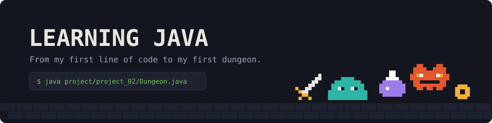
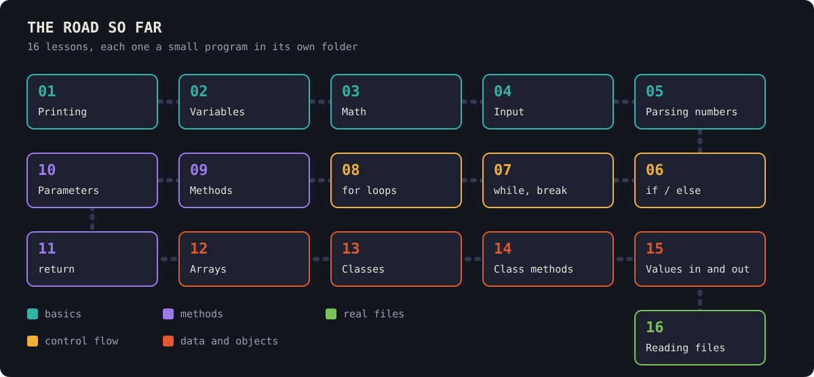
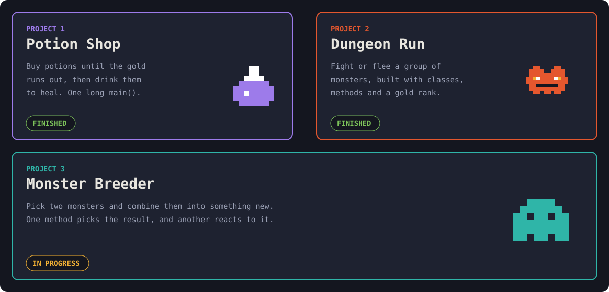
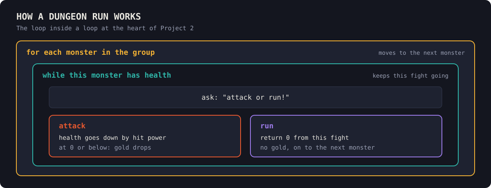

<p align="center">
  
</p>

# Java

This repo is my record of learning Java with no programming experience. Each lesson is one small idea in its own folder, followed by exercises and bigger projects that put the ideas together.

<p align="center">
  
</p>

## Lessons

| # | Topic | Example | My practice |
|---|---|---|---|
| 01 | Printing and reading errors | | [Hello](lesson01/Hello.java) |
| 02 | Variables | | [Boxes](lesson02/Boxes.java) |
| 03 | Changing variables and math | [Change](lesson03/Change.java) | [Coins](lesson03/Coins.java) |
| 04 | Asking questions | [Ask](lesson04/Ask.java) | [Story](lesson04/Story.java), [Collection](lesson04/Collection.java) |
| 05 | Turning answers into numbers | [Numbers](lesson05/Numbers.java) | [Pure](lesson05/Pure.java) (coin purse) |
| 06 | `if` / `else` and `.equals` | [Decide](lesson06/Decide.java) | added to [Pure](lesson05/Pure.java) |
| 07 | `while` and `break` | [Loop](lesson07/Loop.java) | added to [Pure](lesson05/Pure.java) |
| 08 | `for` loops | [Counting](lesson08/Counting.java) | [Times](lesson08/Times.java) |
| 09 | Writing my own methods | [Commands](lesson09/Commands.java) | [Menu](lesson09/Menu.java) |
| 10 | Giving methods information | [Info](lesson10/Info.java) | [Battle](lesson10/Battle.java) |
| 11 | Methods that `return` an answer | [Answers](lesson11/Answers.java) | [Battle](lesson11/Battle.java) |
| 12 | Arrays | [Lists](lesson12/Lists.java) | [Parade](lesson12/Parade.java) |
| 13 | Classes and objects | [Potions](lesson13/Potions.java) | [Monsters](lesson13/Monsters.java) |
| 14 | Methods inside a class | [Healing](lesson14/Healing.java) | [Dojo](lesson14/Dojo.java) |
| 15 | Class methods that take values and hand them back | [Healer](lesson15/Healer.java) | [Arena](lesson15/Arena.java) |
| 16 | Reading real files | [FileStats](lesson16/FileStats.java) | [Search](lesson16/Search.java), [Notes](lesson16/Notes.java) |
| 17 | Writing to a file | [SaveNote](lesson17/SaveNote.java) | |
| 18 | `try` / `catch` | [Age](lesson18/Age.java) | [SafeOpen](lesson18/SafeOpen.java) |
| 19 | `.split`, `.trim` and `switch` | [Schedule](lesson19/Schedule.java) | [Grade](lesson19/Grade.java) |
| 20 | Making my own exceptions | [AgeCheck](lesson20/AgeCheck.java) | [GradeCheck](lesson20/GradeCheck.java) |

**Review:** [login](review/login.java) is a password lock I wrote from a blank file, with no examples, to test the basics.

## Projects

<p align="center">
  
</p>

- **[Potion Shop](project/project_01/project_01.java):** my first project that combined the early lessons.
- **[Dungeon Run](project/project_02/Dungeon.java):** fight or flee three monsters, then get a gold total and a rank. Hit power and the fight each have their own method.
- **[Monster Breeder](project/project_03/MonsterSpawn.java):** my first project from a blank file. Pick two monsters to combine, and one method works out the result while another reacts to it.

<p align="center">
  
</p>

## Run it

You need JDK 25 or newer, because these files use Java's short `void main()` style. I'm using JDK 27. There's nothing to build: run any file directly from this folder.

```
java lesson01/Hello.java
java project/project_02/Dungeon.java
java lesson16/Search.java
```

`Search` and `Notes` work on real files. Give them a path from this folder, like `lesson14/Dojo.java`.

## What's next

Getting ready for my first Java exam:

- Lesson 21: `Scanner` and the classic `public static void main` style
- A date converter, a sentence file editor, and shapes with inheritance
- Keep building Monster Breeder
