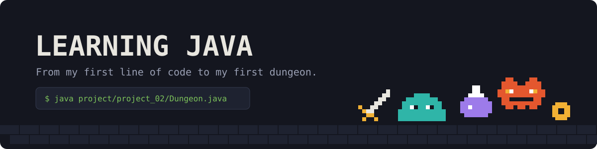
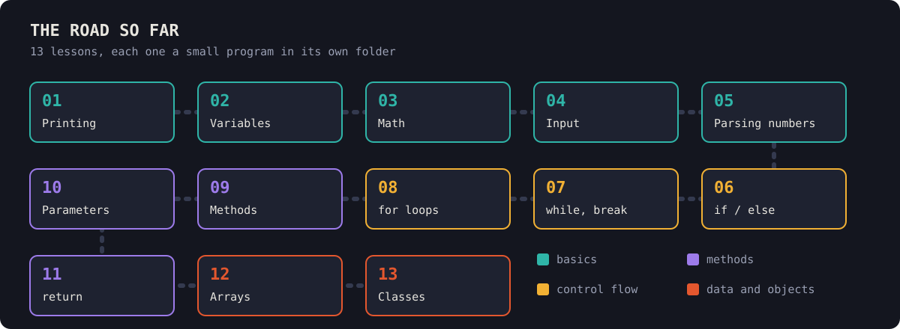
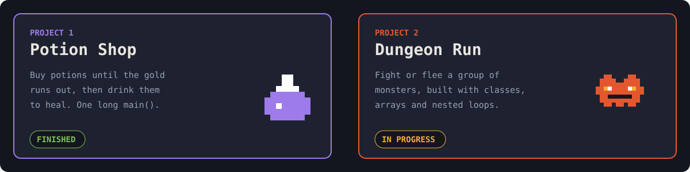
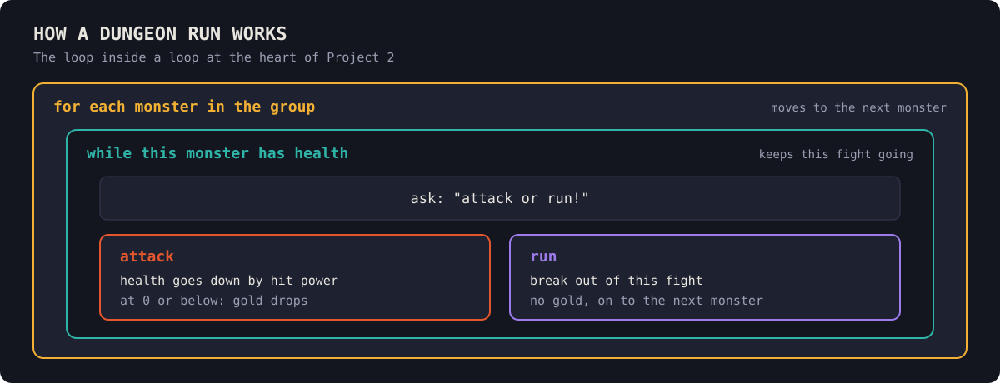

<p align="center">
  
</p>

# Java

This repo is my record of learning Java with no programming experience. Each lesson is one small idea in its own folder, followed by exercises and bigger projects that put the ideas together.

<p align="center">
  
</p>

## Lessons

| # | Topic | Example | My practice |
|---|---|---|---|
| 01 | Printing and reading errors | | [Hello](lesson01/Hello.java) |
| 02 | Variables | | [Boxes](lesson02/Boxes.java) |
| 03 | Changing variables and math | [Change](lesson03/Change.java) | [Coins](lesson03/Coins.java) |
| 04 | Asking questions | [Ask](lesson04/Ask.java) | [Story](lesson04/Story.java), [Collection](lesson04/Collection.java) |
| 05 | Turning answers into numbers | [Numbers](lesson05/Numbers.java) | [Pure](lesson05/Pure.java) (coin purse) |
| 06 | `if` / `else` and `.equals` | [Decide](lesson06/Decide.java) | added to [Pure](lesson05/Pure.java) |
| 07 | `while` and `break` | [Loop](lesson07/Loop.java) | added to [Pure](lesson05/Pure.java) |
| 08 | `for` loops | [Counting](lesson08/Counting.java) | [Times](lesson08/Times.java) |
| 09 | Writing my own methods | [Commands](lesson09/Commands.java) | [Menu](lesson09/Menu.java) |
| 10 | Giving methods information | [Info](lesson10/Info.java) | [Battle](lesson10/Battle.java) |
| 11 | Methods that `return` an answer | [Answers](lesson11/Answers.java) | [Battle](lesson11/Battle.java) |
| 12 | Arrays | [Lists](lesson12/Lists.java) | [Parade](lesson12/Parade.java) |
| 13 | Classes and objects | [Potions](lesson13/Potions.java) | [Monsters](lesson13/Monsters.java) |

## Projects

<p align="center">
  
</p>

- **[Potion Shop](project/project_01/project_01.java):** my first project that combined the early lessons.
- **[Dungeon Run](project/project_02/Dungeon.java):** the fighting works. I still plan to add a gold total, a rank at the end, and methods for the fight and hit power.

<p align="center">
  
</p>

## Run it

You need JDK 25 or newer, because these files use Java's short `void main()` style. I'm using JDK 27. There's nothing to build: run any file directly from this folder.

```
java lesson01/Hello.java
java project/project_02/Dungeon.java
```

## What's next

- Finish Dungeon Run
- Lesson 14: methods inside a class
